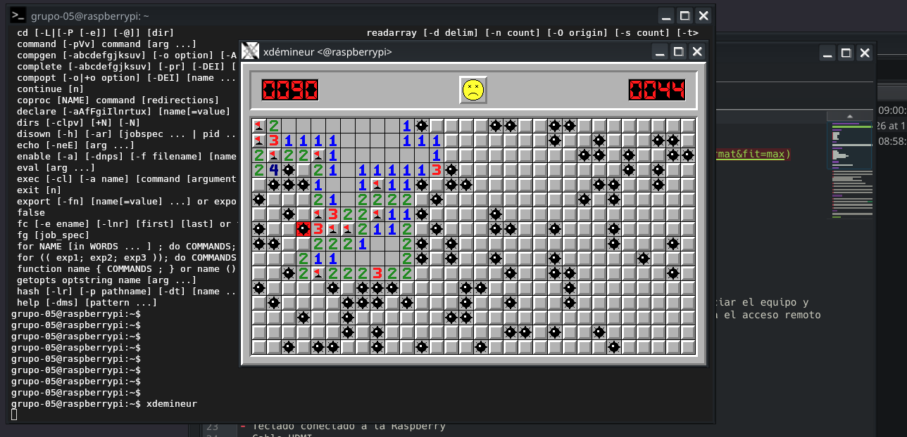

# Entrega 2: Instalación y configuración de X11 mediante SSH


## Integrantes del Grupo 5

- Lorenzo Palacios
- Benjamin Fasioli
- Octavio Paez
- Ramiro Cardo
- Sebastian Weiss

## Objetivo

Configurar el reenvío de X11 mediante SSH en una Raspberry Pi para ejecutar aplicaciones gráficas de forma remota y visualizar sus ventanas en una computadora cliente a través de una conexión cifrada.

## Entorno de trabajo

Antes de entregar el informe, completar los siguientes datos con la información utilizada durante la práctica:

| Elemento | Información |
|---|---|
| Modelo de Raspberry Pi | **[Raspberry Pi b+]** |
| Sistema operativo de la Raspberry Pi | **[Raspberry Pi os Lite]** |
| Tipo de conexión de red | **[Ethernet]** |
| Nombre del usuario de la Raspberry Pi | **[grupo-05]** |
| Aplicación gráfica utilizada | **[XDEmineur]** |

Ambos equipos se encontraban conectados a la misma red local durante la actividad.

## Materiales y recursos utilizados

- Raspberry Pi.
- Tarjeta microSD con el sistema operativo instalado.
- Computadora cliente con un entorno gráfico compatible con X11 o XWayland.
- Conexión de red local mediante Ethernet o Wi-Fi.
- Fuente de alimentación para la Raspberry Pi.
- Monitor, teclado y cable HDMI para la configuración inicial de la Raspberry Pi.
- Cliente y servidor OpenSSH.
- Paquete `xauth`.
- Aplicación gráfica utilizada para comprobar el funcionamiento.
- Guía de referencia: [How to forward X over SSH to run graphics applications remotely](https://unix.stackexchange.com/questions/12755/how-to-forward-x-over-ssh-to-run-graphics-applications-remotely).

## Definiciones

### Sistema de Ventanas X

El Sistema de Ventanas X es un sistema gráfico utilizado en sistemas operativos basados en Unix y Linux. Se encarga de permitir que las aplicaciones gráficas dibujen ventanas y reciban acciones del teclado y del mouse.

### X11

X11 es la versión 11 del protocolo del Sistema de Ventanas X y es la versión utilizada actualmente con mayor frecuencia.

### Xorg

Xorg es una de las implementaciones más utilizadas del servidor gráfico X. El servidor X se ejecuta en el equipo que muestra las ventanas, que en esta práctica fue la computadora cliente.

### SSH

SSH (*Secure Shell*) es un protocolo que permite conectarse y administrar de manera remota otro equipo mediante un canal cifrado.

### X11 Forwarding

X11 Forwarding es una función de SSH que permite ejecutar una aplicación gráfica en un equipo remoto y mostrar su ventana en el equipo local. En esta práctica, la aplicación se ejecutó en la Raspberry Pi, pero su ventana se visualizó en la computadora cliente.

### `xauth`

`xauth` es una herramienta que gestiona la información de autenticación utilizada por X11. SSH la utiliza para autorizar de forma temporal y segura la conexión de la aplicación gráfica remota con el servidor gráfico del equipo local.

> **Aclaración:** desde el punto de vista de SSH, la Raspberry Pi funcionó como servidor y la computadora como cliente. En la arquitectura de X11, la computadora local ejecutó el servidor gráfico y la aplicación abierta en la Raspberry Pi actuó como cliente gráfico.

## Procedimiento

### 1. Verificación del servicio SSH

En la Raspberry Pi, verificamos que el servicio SSH estuviera instalado y activo:

```bash
sudo systemctl status ssh
```

El resultado esperado debía indicar:

```text
active (running)
```

Si el servicio no estaba habilitado, podía activarse mediante los siguientes comandos:

```bash
sudo systemctl enable ssh
sudo systemctl start ssh
```

En estos comandos:

- `sudo` ejecuta la orden con privilegios de administrador.
- `systemctl` administra los servicios del sistema.
- `enable` configura el servicio para que se inicie automáticamente.
- `start` inicia el servicio en ese momento.

### 2. Modificación de la configuración del servidor SSH

Desde la Raspberry Pi, abrimos el archivo de configuración del servidor SSH:

```bash
sudo nano /etc/ssh/sshd_config
```

En este comando:

- `sudo` ejecuta la orden con privilegios de administrador, necesarios para modificar un archivo del sistema.
- `nano` es un editor de texto que funciona desde la terminal.
- `/etc/ssh/sshd_config` es el archivo de configuración del servidor SSH.

Buscamos la opción correspondiente y comprobamos que estuviera escrita sin el símbolo `#` al comienzo:

```text
X11Forwarding yes
```

El valor `yes` habilita el reenvío de aplicaciones gráficas a través de SSH.

Guardamos los cambios en `nano` mediante `Ctrl + O`, confirmamos con `Enter` y cerramos el editor con `Ctrl + X`.

### 3. Validación de la configuración

Antes de reiniciar el servicio, verificamos que el archivo de configuración no tuviera errores de sintaxis:

```bash
sudo sshd -t
```

Si el comando no muestra ningún mensaje, significa que no se detectaron errores de sintaxis.

También verificamos que la opción estuviera activa:

```bash
grep -i "^X11Forwarding" /etc/ssh/sshd_config
```

El resultado esperado era:

```text
X11Forwarding yes
```

### 4. Reinicio del servicio SSH

Para aplicar la nueva configuración, reiniciamos el servicio:

```bash
sudo systemctl restart ssh
```

Después comprobamos nuevamente su estado:

```bash
sudo systemctl status ssh
```

### 5. Verificación de `xauth`

Comprobamos si `xauth` estaba instalado mediante:

```bash
which xauth
```

En nuestro caso, el programa ya se encontraba instalado. El comando mostró una ruta similar a la siguiente:

```text
/usr/bin/xauth
```

Si no hubiera estado instalado, se podría haber agregado con:

```bash
sudo apt update
sudo apt install xauth
```

En estos comandos:

- `apt` es el administrador de paquetes utilizado en Debian y sus distribuciones derivadas.
- `update` actualiza la información de los paquetes disponibles.
- `install` instala el paquete indicado.

### 6. Verificación de la computadora cliente

En la computadora cliente no fue necesario instalar software adicional porque ya disponía de:

- Un cliente OpenSSH.
- Un entorno gráfico compatible con X11 o XWayland.
- Los componentes necesarios para mostrar aplicaciones X11.

El tipo de sesión gráfica puede comprobarse con:

```bash
echo $XDG_SESSION_TYPE
```

El resultado puede ser `x11` o `wayland`. En una sesión Wayland, las aplicaciones X11 pueden mostrarse mediante XWayland, si se encuentra disponible.

### 7. Conexión mediante SSH con X11 Forwarding

Desde la computadora cliente, iniciamos la conexión agregando la opción `-X`:

```bash
ssh -X usuario@direccion_ip
```

El comando utilizado por el grupo fue:

```bash
ssh -X [USUARIO]@[DIRECCIÓN_IP_DE_LA_RASPBERRY]
```

Antes de entregar, deben reemplazarse los campos entre corchetes por los datos utilizados, sin incluir la contraseña.

En este comando:

- `ssh` inicia una conexión remota segura.
- `-X` habilita el reenvío X11 con restricciones de seguridad.
- `usuario` identifica la cuenta existente en la Raspberry Pi.
- `direccion_ip` indica la dirección de la Raspberry Pi dentro de la red.

### 8. Verificación de la variable `DISPLAY`

Una vez iniciada la sesión remota, comprobamos que SSH hubiera configurado la variable `DISPLAY`:

```bash
echo $DISPLAY
```

El resultado esperado debía ser similar a:

```text
localhost:10.0
```

El número puede variar. Lo importante es que la variable no se encuentre vacía, ya que indica a las aplicaciones gráficas dónde deben mostrar sus ventanas.

### 9. Instalación y ejecución de la aplicación gráfica

Para comprobar el funcionamiento, instalamos una aplicación de buscaminas liviana en la Raspberry Pi.

> **Completar esta sección con los comandos exactos utilizados durante la práctica. No indicar un paquete diferente del que realmente se instaló.**

```bash
sudo apt update
sudo apt install [NOMBRE_DEL_PAQUETE]
```

Luego ejecutamos la aplicación desde la misma sesión SSH:

```bash
[COMANDO_DE_EJECUCIÓN]
```

La aplicación se ejecutó en la Raspberry Pi, pero su ventana apareció en la computadora cliente. Esto confirmó que el reenvío X11 funcionaba correctamente.

## Opción `-X` y opción `-Y`

SSH ofrece dos opciones relacionadas con el reenvío X11:

| Opción | Funcionamiento | Seguridad |
|---|---|---|
| `-X` | Habilita un reenvío X11 con restricciones. | Es la opción recomendada para esta práctica. |
| `-Y` | Habilita un reenvío X11 considerado confiable. | Tiene menos restricciones, pero concede más permisos a las aplicaciones remotas. |

Utilizamos `-X` porque ofrece mayores restricciones de seguridad. La opción `-Y` debería emplearse únicamente cuando se confía en el equipo remoto y una aplicación no funciona correctamente con `-X`.

## Comprobaciones realizadas

| Comprobación | Comando | Resultado esperado |
|---|---|---|
| Estado del servicio SSH | `sudo systemctl status ssh` | `active (running)` |
| Sintaxis de la configuración | `sudo sshd -t` | Sin mensajes de error |
| Reenvío X11 habilitado | `grep -i "^X11Forwarding" /etc/ssh/sshd_config` | `X11Forwarding yes` |
| Instalación de `xauth` | `which xauth` | Una ruta como `/usr/bin/xauth` |
| Conexión con reenvío gráfico | `ssh -X usuario@direccion_ip` | Conexión iniciada correctamente |
| Variable gráfica | `echo $DISPLAY` | Un valor similar a `localhost:10.0` |
| Aplicación remota | Comando del buscaminas | Ventana visible en la computadora cliente |

## Resultado

La prueba fue exitosa: el buscaminas se ejecutó en la Raspberry Pi y su ventana se mostró en la computadora cliente a través de la conexión SSH.



**Figura 1.** Aplicación de buscaminas ejecutada en la Raspberry Pi y visualizada en la computadora cliente mediante X11 Forwarding sobre SSH.

## Posibles errores y soluciones

### La variable `DISPLAY` aparece vacía

Se debe comprobar que:

- La conexión se haya iniciado con `ssh -X`.
- La línea `X11Forwarding yes` se encuentre activa en `/etc/ssh/sshd_config`.
- El servicio SSH se haya reiniciado después de modificar el archivo.
- `xauth` esté instalado en la Raspberry Pi.

### La aplicación indica que no puede abrir la pantalla

Puede aparecer un mensaje similar a:

```text
Error: Can't open display
```

En ese caso, se debe revisar el valor de `DISPLAY`, la disponibilidad del entorno X11 o XWayland en la computadora cliente y la configuración del servidor SSH.

### La conexión SSH funciona, pero la ventana no aparece

Se puede iniciar la conexión en modo detallado para revisar el proceso:

```bash
ssh -v -X usuario@direccion_ip
```

La opción `-v` muestra información de diagnóstico y permite comprobar si SSH solicitó correctamente el reenvío X11.

## Consideraciones de seguridad

- El tráfico de X11 se transporta dentro del canal cifrado de SSH.
- No se deben escribir contraseñas dentro del informe ni mostrarlas en capturas de pantalla.
- Es preferible utilizar `ssh -X` en lugar de `ssh -Y`, salvo que exista una razón técnica justificada.
- Solo se deben ejecutar aplicaciones provenientes de equipos remotos confiables.
- No es recomendable desactivar controles de autenticación mediante comandos como `xhost +`, debido a que permitirían conexiones gráficas sin una restricción adecuada.

## Conclusión

Con esta actividad logramos configurar y comprobar el reenvío X11 mediante SSH. La aplicación gráfica se ejecutó en la Raspberry Pi, mientras que su ventana se mostró en la computadora cliente por medio de una conexión cifrada.

También comprendimos la función de la opción `-X`, de la herramienta `xauth`, de la variable `DISPLAY` y del archivo `/etc/ssh/sshd_config`. La ejecución del buscaminas confirmó que la configuración funcionaba correctamente.

Esta configuración puede facilitar la administración remota de aplicaciones gráficas instaladas en la Raspberry Pi. Sin embargo, X11 Forwarding no es un requisito para utilizar posteriormente la Raspberry Pi como router, sino una herramienta adicional para su administración remota.

## Evidencias recomendadas para la entrega

Para que el procedimiento quede completamente demostrado, se recomienda incluir capturas de:

1. La línea `X11Forwarding yes` en `/etc/ssh/sshd_config`.
2. El resultado de `sudo sshd -t` y `sudo systemctl status ssh`.
3. La comprobación de `xauth` mediante `which xauth`.
4. La conexión realizada con `ssh -X`.
5. El resultado de `echo $DISPLAY`.
6. La ventana del buscaminas visible en la computadora cliente.

Cada captura debe tener un número, un título breve y una explicación de lo que demuestra.
