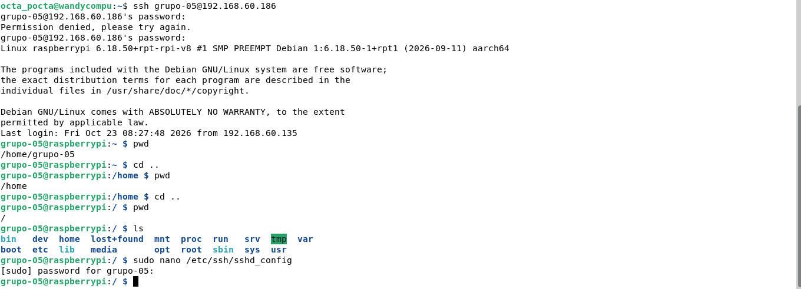
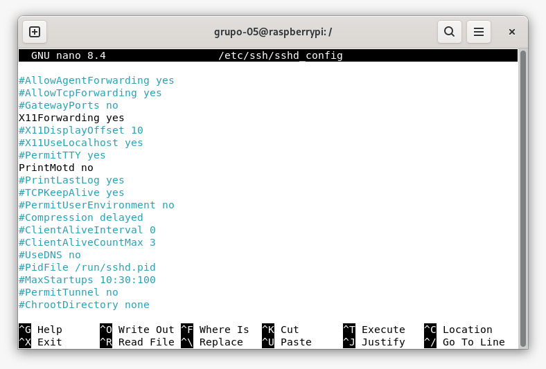
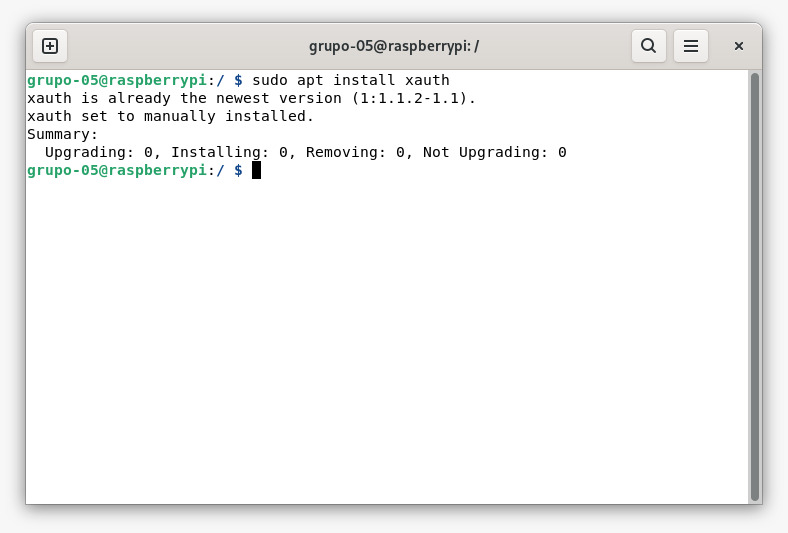
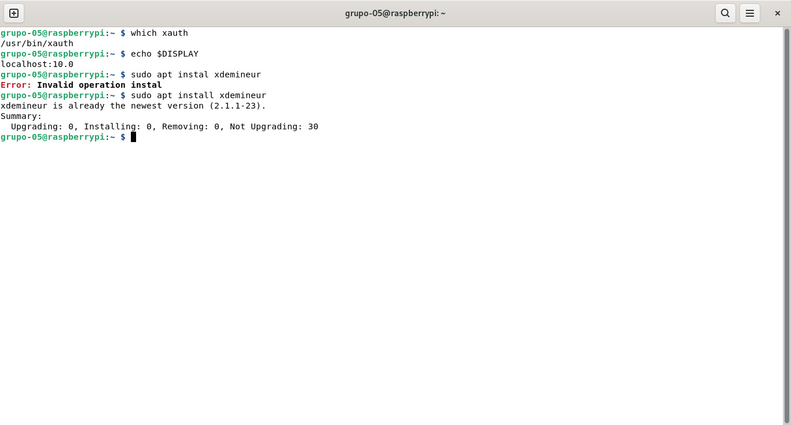
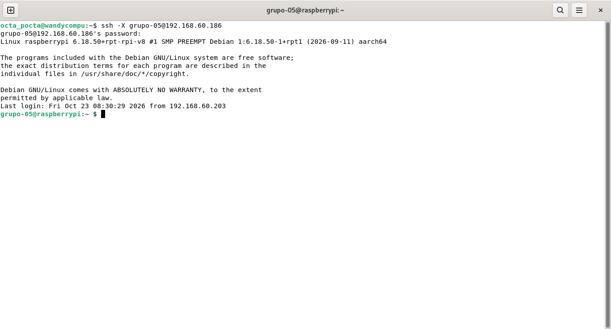
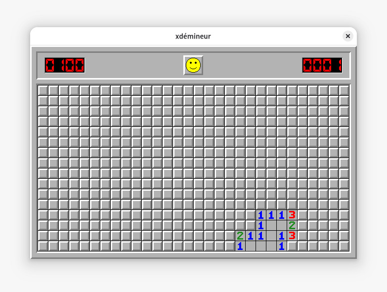

[← Volver](../README.md)
# Entrega 2: Instalación y configuración de X11 mediante SSH


## Integrantes del Grupo 5

- Lorenzo Palacios
- Benjamin Fasioli
- Octavio Paez
- Ramiro Cardo
- Sebastian Weiss

## Objetivo

Configurar el reenvío de X11 mediante SSH en una Raspberry Pi para ejecutar aplicaciones gráficas de forma remota y visualizar sus ventanas en una computadora cliente a través de una conexión cifrada.

## Entorno de trabajo

| Elemento | Información |
|---|---|
| Modelo de Raspberry Pi | **[Raspberry Pi b+]** |
| Sistema operativo de la Raspberry Pi | **[Raspberry Pi os Lite]** |
| Tipo de conexión de red | **[Ethernet]** |
| Nombre del usuario de la Raspberry Pi | **[grupo-05]** |
| Aplicación gráfica utilizada | **[xdEmineur]** |

Ambos equipos se encontraban conectados a la misma red local durante la actividad.

## Materiales y recursos utilizados

- Raspberry Pi.
- Tarjeta microSD con el sistema operativo instalado.
- Computadora cliente con un entorno gráfico compatible con X11 o XWayland.
- Conexión de red local mediante Ethernet o Wi-Fi.
- Fuente de alimentación para la Raspberry Pi.
- Monitor, teclado y cable HDMI para la configuración inicial de la Raspberry Pi.
- Cliente y servidor OpenSSH.
- Paquete `xauth`.
- xdemineur.
- Guía de referencia: [How to forward X over SSH to run graphics applications remotely](https://unix.stackexchange.com/questions/12755/how-to-forward-x-over-ssh-to-run-graphics-applications-remotely).

## Definiciones

### Sistema de Ventanas X

El Sistema de Ventanas X es un sistema gráfico utilizado en sistemas operativos basados en Unix y Linux. Se encarga de permitir que las aplicaciones gráficas dibujen ventanas y reciban acciones del teclado y del mouse.

### X11

X11 es la versión 11 del protocolo del Sistema de Ventanas X y es la versión utilizada actualmente con mayor frecuencia.

### Xorg

Xorg es una de las implementaciones más utilizadas del servidor gráfico X. El servidor X se ejecuta en el equipo que muestra las ventanas, que en esta práctica fue la computadora cliente.

### SSH

SSH (*Secure Shell*) es un protocolo que permite conectarse y administrar de manera remota otro equipo mediante un canal cifrado.

### X11 Forwarding

X11 Forwarding es una función de SSH que permite ejecutar una aplicación gráfica en un equipo remoto y mostrar su ventana en el equipo local. En esta práctica, la aplicación se ejecutó en la Raspberry Pi, pero su ventana se visualizó en la computadora cliente.

### `xauth`

`xauth` es una herramienta que gestiona la información de autenticación utilizada por X11. SSH la utiliza para autorizar de forma temporal y segura la conexión de la aplicación gráfica remota con el servidor gráfico del equipo local.

> **Aclaración:** desde el punto de vista de SSH, la Raspberry Pi funcionó como servidor y la computadora como cliente. En la arquitectura de X11, la computadora local ejecutó el servidor gráfico y la aplicación abierta en la Raspberry Pi actuó como cliente gráfico.

## Procedimiento

### 1. Verificación del servicio SSH

Nos conectamos a la raspberry mediante ssh con el comando ssh nombre@ip_de_raspberry:



### 2. Cambiamos el archivo de configuración ssh (/etc/ssh/sshd_config) del lado server (la raspberry) para añadir el argumento 'X11Forwarding yes'. Usamos como comando sudo nano <ruta-del-archivo>. En el cual:

Desde la Raspberry Pi, abrimos el archivo de configuración del servidor SSH:

```bash
sudo nano /etc/ssh/sshd_config
```

En este comando:

- `sudo` ejecuta la orden con privilegios de administrador, necesarios para modificar un archivo del sistema.
- `nano` es un editor de texto que funciona desde la terminal.
- `/etc/ssh/sshd_config` es el archivo de configuración del servidor SSH.

Buscamos la opción correspondiente y comprobamos que estuviera escrita sin el símbolo `#` al comienzo:

```text
X11Forwarding yes
```

El valor `yes` habilita el reenvío de aplicaciones gráficas a través de SSH.

Guardamos los cambios en `nano` mediante `Ctrl + O`, confirmamos con `Enter` y cerramos el editor con `Ctrl + X`.


### 3. Descubrimos que el programa para la autenticación de X11 para forwarding ya vino preinstalado entonces no nos hizo falta instalarlo con el comando sudo apt install xauth. Donde:
- sudo: explicado previamente
- apt: 'advanced package tool' administrador de paquetes en sistemas basados en Debian.
- install: argumento de instalación de apt




### 4. Del lado cliente (nuestra pc), no hizo falta configurar o instalar nada porque ambos lados de la operación (cliente y server) son sistemas basados en Debian y son naturalmente compatibles, además de ya tener todos los paquetes importantes de X11 instalados ya que es una computadora de uso comun.

### 5. Verificación de `xauth`

Comprobamos si `xauth` estaba instalado mediante:

```bash
which xauth
```
-"which": localiza la ruta de un archivo ejecutable

En nuestro caso, el programa ya se encontraba instalado. El comando mostró una ruta similar a la siguiente:

```text
/usr/bin/xauth
```

Si no hubiera estado instalado, se podría haber agregado con:

```bash
sudo apt update
sudo apt install xauth
```

En estos comandos:

- `apt` es el administrador de paquetes utilizado en Debian y sus distribuciones derivadas.
- `update` actualiza la información de los paquetes disponibles.
- `install` instala el paquete indicado.



### 6. Conexion con ssh y x

Corremos casi el mismo comando ssh para conenctarnos con la única diferencia de que ahora añadimos el argumento '-X' al ssh, lo que permite el forwarding X11 y lo autentifica con xauth.

El comando queda:

```bash
ssh -X usuario@direccion_ip
```
En este comando:

- `ssh` inicia una conexión remota segura.
- `-X` habilita el reenvío X11 con restricciones de seguridad.
- `usuario` identifica la cuenta existente en la Raspberry Pi.
- `direccion_ip` indica la dirección de la Raspberry Pi dentro de la red.

### 8. Verificación de la variable `DISPLAY`

Una vez iniciada la sesión remota, comprobamos que SSH hubiera configurado la variable `DISPLAY`:

```bash
echo $DISPLAY
```

El resultado esperado debía ser similar a:

```text
localhost:10.0
```


### 8. Instalación y ejecución de la aplicación gráfica

Para comprobar el funcionamiento, instalamos una aplicación de buscaminas liviana en la Raspberry Pi.

```bash
sudo apt install xdemineur
```

Luego ejecutamos la aplicación desde la misma sesión SSH:

```bash
xdemineur
```

La aplicación se ejecutó en la Raspberry Pi, pero su ventana apareció en la computadora cliente. Esto confirmó que el reenvío X11 funcionaba correctamente.




## Opción `-X` y opción `-Y`

SSH ofrece dos opciones relacionadas con el reenvío X11:

| Opción | Funcionamiento | Seguridad |
|---|---|---|
| `-X` | Habilita un reenvío X11 con restricciones. | Es la opción recomendada para esta práctica. |
| `-Y` | Habilita un reenvío X11 considerado confiable. | Tiene menos restricciones, pero concede más permisos a las aplicaciones remotas. |

Utilizamos `-X` porque ofrece mayores restricciones de seguridad. La opción `-Y` debería emplearse únicamente cuando se confía en el equipo remoto y una aplicación no funciona correctamente con `-X`.

## Comprobaciones realizadas

| Comprobación | Comando | Resultado esperado |
|---|---|---|
| Estado del servicio SSH | `sudo systemctl status ssh` | `active (running)` |
| Sintaxis de la configuración | `sudo sshd -t` | Sin mensajes de error |
| Reenvío X11 habilitado | `grep -i "^X11Forwarding" /etc/ssh/sshd_config` | `X11Forwarding yes` |
| Instalación de `xauth` | `which xauth` | Una ruta como `/usr/bin/xauth` |
| Conexión con reenvío gráfico | `ssh -X usuario@direccion_ip` | Conexión iniciada correctamente |
| Variable gráfica | `echo $DISPLAY` | Un valor similar a `localhost:10.0` |
| Aplicación remota | Comando del buscaminas | Ventana visible en la computadora cliente |

## Resultado

La prueba fue exitosa: el buscaminas se ejecutó en la Raspberry Pi y su ventana se mostró en la computadora cliente a través de la conexión SSH.


**Figura 1.** Aplicación de buscaminas ejecutada en la Raspberry Pi y visualizada en la computadora cliente mediante X11 Forwarding sobre SSH.


## Conclusión

Con esta actividad logramos configurar y comprobar el reenvío X11 mediante SSH. La aplicación gráfica se ejecutó en la Raspberry Pi, mientras que su ventana se mostró en la computadora cliente por medio de una conexión cifrada.

También comprendimos la función de la opción `-X`, de la herramienta `xauth`, de la variable `DISPLAY` y del archivo `/etc/ssh/sshd_config`. La ejecución del buscaminas confirmó que la configuración funcionaba correctamente.

Esta configuración puede facilitar la administración remota de aplicaciones gráficas instaladas en la Raspberry Pi. Sin embargo, X11 Forwarding no es un requisito para utilizar posteriormente la Raspberry Pi como router, sino una herramienta adicional para su administración remota.
