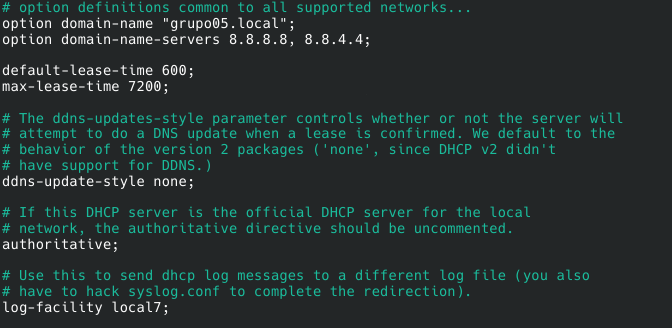
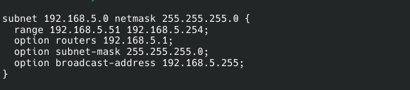
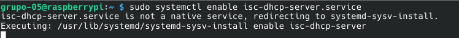
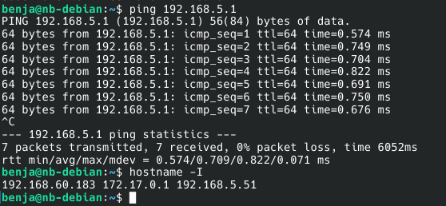

[← Volver](../README.md)
# Entrega 3: Instalación y Configuracion de DHCP Server


## Integrantes del Grupo 5

- Lorenzo Palacios
- Benjamin Fasioli
- Octavio Páez Scruzzi
- Ramiro Cardo
- Sebastian Weiss

## Objetivo

COnfigurar el servicio DHCP para que la Raspberry Pi funcione como el servidor proporcionandole así direcciones IP a las Notebook.

## Entorno de trabajo


| Elemento | Información |
|---|---|
| Modelo de Raspberry Pi | **[Raspberry Pi 4 b+]** |
| Sistema operativo de la Raspberry Pi | **[Raspberry Pi os Lite]** |
| Tipo de conexión de red | **[Ethernet]** |
| Nombre del usuario de la Raspberry Pi | **[grupo-05]** |


## Materiales y recursos utilizados

- Raspberry Pi.
- Tarjeta microSD con el sistema operativo instalado.
- Computadora cliente con un entorno gráfico compatible con X11 o XWayland.
- Conexión de red local mediante Ethernet o Wi-Fi.
- Fuente de alimentación para la Raspberry Pi.
- Monitor, teclado y cable HDMI para la configuración inicial de la Raspberry Pi.
- Cliente y servidor OpenSSH.
- Paquete `isc-dhcp-server`.
- NetworkManager y su herramienta `nmtui`.
- Cisco Packet Tracer para representar el diseño de la red.


## Definiciones

### DHCP

DHCP (*Dynamic Host Configuration Protocol*) es un protocolo de red que permite asignar automáticamente parámetros de configuración a los dispositivos conectados a una red.

Entre los parámetros que puede proporcionar se encuentran:

- Dirección IP.
- Máscara de subred.
- Puerta de enlace predeterminada (gateway).
- Servidores DNS.

De esta manera, no es necesario configurar manualmente estos datos en cada computadora que se conecta a la red.

### Servidor DHCP

Es el dispositivo que administra y asigna las direcciones IP a los clientes de una red. Mantiene un conjunto de direcciones disponibles y controla las concesiones realizadas.

En esta práctica, la Raspberry Pi cumplió esta función.

### Cliente DHCP

Es un dispositivo que solicita automáticamente al servidor DHCP los parámetros necesarios para conectarse a la red.

En esta práctica, la computadora cliente fue la encargada de solicitar una dirección IP a la Raspberry Pi.

### Dirección IP

Una dirección IP (*Internet Protocol*) es un identificador lógico asignado a una interfaz de red. Permite identificar dispositivos y establecer comunicaciones dentro de una red o entre redes diferentes.

En esta práctica se utilizó la red `192.168.5.0/24`.

### Dirección MAC

La dirección MAC (*Media Access Control*) es un identificador asociado a una interfaz de red y utilizado en la comunicación dentro de una red local.

DHCP puede utilizar la dirección MAC del cliente para identificarlo durante el proceso de asignación de una dirección IP.

### Máscara de subred

La máscara de subred permite determinar qué parte de una dirección IP identifica a la red y qué parte identifica al dispositivo.

En esta práctica se utilizó la máscara `255.255.255.0`, equivalente a `/24`.

### Gateway

La puerta de enlace predeterminada o gateway es el dispositivo al que una computadora envía los paquetes destinados a otras redes.

En esta práctica se configuró la Raspberry Pi como gateway previsto para la red local, ya que posteriormente se utilizará como router.

### DNS

DNS (*Domain Name System*) es un sistema que permite traducir nombres de dominio a direcciones IP.

Por ejemplo, permite encontrar la dirección IP asociada a un nombre como `google.com`.

El servidor DHCP puede informar a los clientes qué servidores DNS deben utilizar.

### Concesión DHCP

Una concesión o *lease* es el período durante el cual un servidor DHCP autoriza a un cliente a utilizar una determinada dirección IP.

Cuando la concesión se aproxima a su vencimiento, el cliente puede solicitar su renovación para continuar utilizando la dirección.

### Protocolo DORA

DORA representa las cuatro etapas principales del proceso inicial de asignación de una dirección IP mediante DHCP:

1. **Discover:** el cliente busca servidores DHCP disponibles mediante un mensaje de difusión (*broadcast*).
2. **Offer:** el servidor ofrece una dirección IP disponible.
3. **Request:** el cliente solicita utilizar la dirección ofrecida.
4. **Acknowledge (ACK):** el servidor confirma la asignación y entrega los parámetros de configuración.

## Esquema de la Red (Cisco Packet Tracer)


## Procedimiento

### 1. Instalación de Paquetes de Servidor DHCP

El primer paso es conectarnos a la Raspberry con ssh e instalar el paquete isc-dhcp-server con lo necesario para la configuración:
```
sudo apt install isc-dhcp-server
```
sudo : Super User Do (Ejecuta lo siguiente como superusuario)
apt: Gestor de paquetes de debian.
install: Indica a apt que debe instalar lo siguiente.
isc-dhcp-server: Es el nombre del paquete que contiene el servicio del servidor DHCP.


## 2. Puerto DHCP
Configuramos /etc/default/isc-dhcp-server para especificar el puerto para la conexion con el resto de la LAN
```
sudo nano /etc/default/isc-dhcp-server
```
nano: editor de archivos de texto de la terminal de linux.

Dentro del archivo configuramos:

```bash
INTERFACESv4="eth0"

INTERFACESv6="eth0"
```

En estas líneas:

- `INTERFACESv4` indica las interfaces por las que el servidor atenderá solicitudes DHCP para IPv4.
- `INTERFACESv6` indica las interfaces por las que atenderá solicitudes DHCP para IPv6.
- `eth0` identifica la interfaz Ethernet de la Raspberry Pi.

Elegimos `eth0` porque la Raspberry se encontraba conectada al switch mediante un cable Ethernet. De esta manera, el servidor DHCP atendería las solicitudes recibidas a través de esa interfaz.

La configuración utilizada en esta práctica se centró en IPv4.


## 3. Copia de Seguridad
Queremos configurar el servicio modificando el archivo /etc/dhcp/dhcpd.conf, asi que para poder recuperarlo en caso de errores lo copiamos con el comandp 'cp'
```
sudo cp /etc/dhcp/dhcpd.conf dhcp.conf
```
- `sudo` permite realizar la operación con los permisos necesarios.
- `cp` es el comando utilizado para copiar archivos.
- `/etc/dhcp/dhcpd.conf` es el archivo original de configuración del servidor DHCP.
- `dhcp.conf` es el nombre asignado al archivo copiado.

La copia se creó en el directorio actual, ya que no se especificó otra ruta de destino.


## 4. Configuracion general del Servicio
Configuramos el archivo general para especificar cosas como la subred, el rango de asignacion, los servidores DNS, etc
(le configuramos un rango de .51 a .254)
Este archivo permite establecer parámetros generales del servicio, como el nombre de dominio, los servidores DNS, los tiempos de concesión, la subred y el rango de direcciones IP disponibles.

Entre las opciones configuradas se encuentran:

```conf
option domain-name "grupo05.local";
option domain-name-servers 8.8.8.8, 8.8.4.4;

default-lease-time 600;
max-lease-time 7200;

ddns-update-style none;
```

**Nombre de dominio:**

```conf
option domain-name "grupo05.local";
```

Establece el nombre de dominio que se puede proporcionar a los clientes DHCP. En este caso se utilizó `grupo05.local` como nombre asociado a la red del grupo.

**Servidores DNS:**

```conf
option domain-name-servers 8.8.8.8, 8.8.4.4;
```

Indica qué servidores DNS deben utilizar los clientes que reciban su configuración mediante DHCP.

- `8.8.8.8` es una dirección del servicio DNS público de Google.
- `8.8.4.4` es otra dirección del servicio DNS público de Google.

Estos servidores permiten resolver nombres de dominio, siempre que los clientes tengan conectividad hacia ellos.

**Tiempo de concesión predeterminado:**

```conf
default-lease-time 600;
```

Establece una duración predeterminada de 600 segundos para las concesiones DHCP, equivalente a 10 minutos.

**Tiempo máximo de concesión:**

```conf
max-lease-time 7200;
```

Establece una duración máxima de 7200 segundos, equivalente a 2 horas.

Estos tiempos permiten administrar las direcciones disponibles y controlar durante cuánto tiempo los clientes pueden utilizar las concesiones.

Una concesión puede renovarse antes de su vencimiento, por lo que la dirección IP no necesariamente cambia cada 10 minutos.

**Actualizaciones dinámicas de DNS:**

```conf
ddns-update-style none;
```

Deshabilita las actualizaciones dinámicas de DNS realizadas por el servidor DHCP. Esto significa que el servidor no intentará modificar automáticamente los registros DNS al asignar direcciones IP.

**Configuración de la subred y del rango:**

La red utilizada fue `192.168.5.0/24`, con máscara `255.255.255.0`.

El rango de direcciones configurado para los clientes fue desde `192.168.5.51` hasta `192.168.5.254`.


```conf
subnet 192.168.5.0 netmask 255.255.255.0 {
    range 192.168.5.51 192.168.5.254;
    option subnet-mask 255.255.255.0;
    option routers 192.168.5.1
    option brodecast-address 192.168.5.255;
}
```



(archivo despues de editado)
## 5. Usando nmtui para configurar la direccion ip del servidor, mascara de subred y gateway
Para que la Raspberry Pi pueda funcionar como servidor DHCP, necesita tener una dirección IP estable y conocida por los clientes.

Por este motivo utilizamos `nmtui`, una herramienta de NetworkManager que permite administrar las conexiones de red mediante una interfaz de texto en la terminal.

Ejecutamos:

```bash
nmtui
```

Se abrió el menú de NetworkManager, donde seleccionamos:

1. `Edit a connection`, para modificar una conexión existente.
2. `Wired connection 1`, correspondiente a la conexión Ethernet.
3. La interfaz `eth0`.
4. La configuración IPv4 manual.

Seleccionamos `Manual` para poder establecer una dirección IP fija en la Raspberry Pi.

Los valores registrados en la configuración fueron:

- Dirección IP: `192.168.5.1`.
- Servidores DNS: `8.8.8.8`, `8.8.4.4` y `1.1.1.1`.

La máscara de subred utilizada para la red fue `255.255.255.0`.

También se configuró `192.168.5.1` como gateway previsto para la red local, ya que posteriormente la Raspberry Pi será utilizada como router.


## 6. Activamos el servicio

```
systemctl enable isc-dhcp-server
```
- `sudo` ejecuta la orden con privilegios de administrador.
- `systemctl` es una herramienta que permite administrar servicios mediante systemd.
- `enable` configura el servicio para que se inicie automáticamente durante el arranque del sistema.
- `isc-dhcp-server` es el nombre del servicio que queremos habilitar.
- 
El mensaje que devuelve es porque el paquete isc-dhcp-server es antiguo y utiliza el servicio legacy sysvinit. Systemd detecta esto y automaticamente nos redirecciona el comando a sysvinit para activarlo

## 7. Chequeamos la conexion con un ping
Finalmente, conectamos la computadora cliente a la Raspberry Pi mediante un switch Ethernet y comprobamos la comunicación entre ambos dispositivos.

Desde la computadora cliente ejecutamos:

```bash
ping 192.168.5.1
```

El comando `ping` permite comprobar si existe comunicación IP con otro dispositivo mediante el envío de mensajes ICMP (*Internet Control Message Protocol*).

En este caso, se enviaron paquetes a la dirección `192.168.5.1`, correspondiente a la Raspberry Pi.

El resultado obtenido fue:

```text
7 packets transmitted, 7 received, 0% packet loss
```

Esto significa que:

- Se enviaron 7 paquetes.
- Se recibieron 7 respuestas.
- No hubo pérdida de paquetes.

Por lo tanto, se comprobó que la computadora cliente podía comunicarse correctamente con la Raspberry Pi a través de la red local.
 


## Comprobaciones realizadas

| Comprobación | Comando o procedimiento | Resultado esperado |
|---|---|---|
| Instalación del servidor DHCP | `sudo apt install isc-dhcp-server` | Instalación correcta del paquete. |
| Selección de interfaz | Edición de `/etc/default/isc-dhcp-server` | `INTERFACESv4="eth0"`. |
| Copia de seguridad | `sudo cp /etc/dhcp/dhcpd.conf dhcp.conf` | Creación del archivo `dhcp.conf`. |
| Configuración del servicio | Edición de `/etc/dhcp/dhcpd.conf` | Subred, rango y opciones correctamente configurados. |
| Dirección IP de la Raspberry | Configuración mediante `nmtui` | `192.168.5.1`. |
| Habilitación del servicio | `sudo systemctl enable isc-dhcp-server` | Servicio habilitado para el arranque automático. |
| Conectividad con la Raspberry | `ping 192.168.5.1` | Respuestas recibidas sin pérdida de paquetes. |
| Dirección IP del cliente | `hostname -I` | Aparición de `192.168.5.51` entre las direcciones del equipo. |
| Concesiones DHCP | `sudo cat /var/lib/dhcp/dhcpd.leases` | Registro de las concesiones entregadas por el servidor. |

## Resultado

La actividad permitió instalar y configurar un servidor DHCP en la Raspberry Pi para administrar automáticamente las direcciones IP de los dispositivos conectados a la red local del grupo 05.

La Raspberry Pi quedó configurada con la dirección estática `192.168.5.1`, mientras que el rango de asignación establecido para los clientes fue desde `192.168.5.51` hasta `192.168.5.254`.

La computadora cliente mostró la dirección `192.168.5.51`, perteneciente al rango configurado, y logró comunicarse con la Raspberry Pi mediante `ping`, obteniéndose siete respuestas y ninguna pérdida de paquetes.

Estos resultados permitieron comprobar la conectividad entre ambos dispositivos y fueron consistentes con el funcionamiento del servidor DHCP configurado.

## Conclusión

Con esta actividad logramos instalar y configurar un servidor DHCP en una Raspberry Pi, permitiendo que los dispositivos conectados a la misma red local puedan obtener automáticamente sus parámetros de configuración.

También comprendimos la función de los archivos `/etc/default/isc-dhcp-server` y `/etc/dhcp/dhcpd.conf`, la selección de la interfaz Ethernet, la asignación de una dirección IP estática y la administración de los tiempos de concesión.

Además, aprendimos cómo intervienen los servidores DNS, la máscara de subred y el gateway en la configuración de los clientes.

Finalmente, mediante las pruebas de conectividad y la observación de la dirección IP de la computadora cliente, comprobamos que ambos dispositivos podían comunicarse dentro de la LAN.

Esta configuración constituye una base para continuar trabajando con la Raspberry Pi como dispositivo de red y posteriormente utilizarla como router, permitiendo conectar la LAN del grupo con otras redes.
