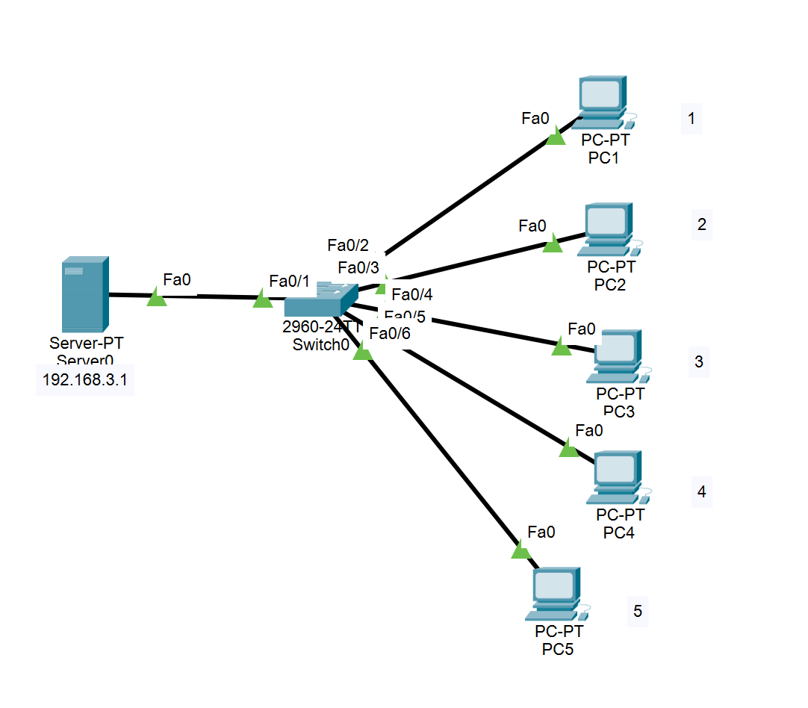
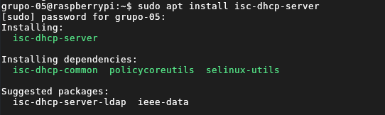
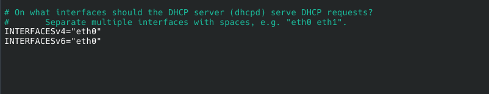
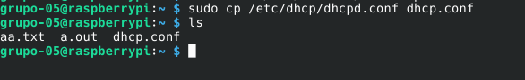
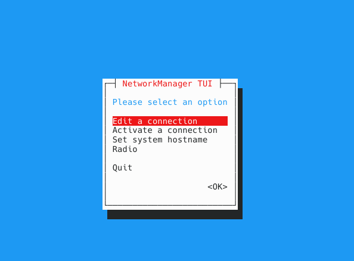
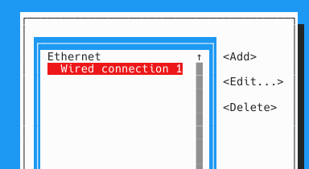
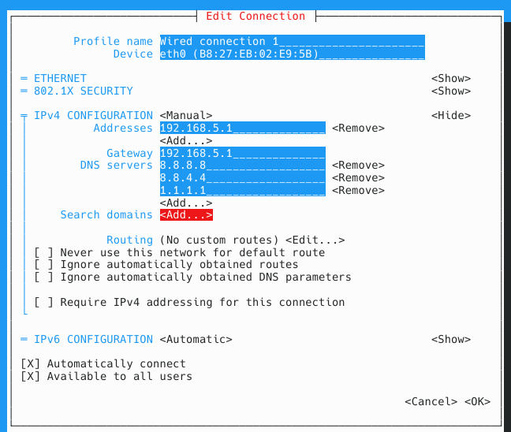

[← Volver](../README.md)
# Entrega 2: Instalación y configuración de X11 mediante SSH


## Integrantes del Grupo 5

- Lorenzo Palacios
- Benjamin Fasioli
- Octavio Paez
- Ramiro Cardo
- Sebastian Weiss

## Objetivo

Configurar el reenvío de X11 mediante SSH en una Raspberry Pi para ejecutar aplicaciones gráficas de forma remota y visualizar sus ventanas en una computadora cliente a través de una conexión cifrada.

## Entorno de trabajo

Antes de entregar el informe, completar los siguientes datos con la información utilizada durante la práctica:

| Elemento | Información |
|---|---|
| Modelo de Raspberry Pi | **[Raspberry Pi b+]** |
| Sistema operativo de la Raspberry Pi | **[Raspberry Pi os Lite]** |
| Tipo de conexión de red | **[Ethernet]** |
| Nombre del usuario de la Raspberry Pi | **[grupo-05]** |
| Aplicación gráfica utilizada | **[XDEmineur]** |

Ambos equipos se encontraban conectados a la misma red local durante la actividad.

## Materiales y recursos utilizados

- Raspberry Pi.
- Tarjeta microSD con el sistema operativo instalado.
- Computadora cliente con un entorno gráfico compatible con X11 o XWayland.
- Conexión de red local mediante Ethernet o Wi-Fi.
- Fuente de alimentación para la Raspberry Pi.
- Monitor, teclado y cable HDMI para la configuración inicial de la Raspberry Pi.
- Cliente y servidor OpenSSH.
- Paquete `isc-dhcp-server`.
- Aplicación gráfica utilizada para comprobar el funcionamiento.
- Guía de referencia: [How to forward X over SSH to run graphics applications remotely](https://sobrebits.com/montar-un-servidor-casero-con-raspberry-pi-parte-3-configurar-servidor-dhcp/).

## Definiciones

## Esquema de la Red (Cisco Packet Tracer)



### Hay uqe poner

## Procedimiento

### 1. Instalación de Paquetes de Servidor DHCP

(tuvimos que deshacer los pasos de la consigna anterior para acceder a internet)
El primer paso es instalar el paquete vsftpd (Very Secure File Transfer Protocol Daemon), para esto, usamos la herramienta de instalación de paquetes apt:
```
sudo apt install vsftpd
```


### 2. Configurar vsftpd

Modificamos el archivo de configuración de vsftpd en la ruta /etc/vsftpd.conf con sudo nano, añadiendo las opciones de local_enable=YES (permite que se logueen los usuarios locales) y write_enable=YES (permite cualquer tipo de comando FTP de escritura en el disco)
```
sudo nano /etc/vsftpd.conf
```


### 3. Configurar vsftpd

Reiniciamos el servicio para aplicar los cambios de configuración
```
sudo service vsftpd restart
```



### 4. Instalar FileZilla

Este es el programa que usamos para comprobar la conexión


### 5. Comprobando la conexión y el funcionamiento con FileZilla

(Volvimos a hacer los ultimos pasos de la guia 3 para reestablecer la lan aislada de notebook y Raspberry)
Nos conectamos al server FTP (la Raspberry) con su direccion ip en nuestra lan (192.168.5.1) y especificamos usuario y contraseña de ingreso


Comprobamos que podemos ver todos los archivos en el home de grupo-05

Creamos un archivo 'pepe.txt' para comprobar que funciona la conexion FTP


## Comprobaciones realizadas

| Comprobación | Comando | Resultado esperado |
|---|---|---|
| Estado del servicio SSH | `sudo systemctl status ssh` | `active (running)` |
| Sintaxis de la configuración | `sudo sshd -t` | Sin mensajes de error |
| Reenvío X11 habilitado | `grep -i "^X11Forwarding" /etc/ssh/sshd_config` | `X11Forwarding yes` |
| Instalación de `xauth` | `which xauth` | Una ruta como `/usr/bin/xauth` |
| Conexión con reenvío gráfico | `ssh -X usuario@direccion_ip` | Conexión iniciada correctamente |
| Variable gráfica | `echo $DISPLAY` | Un valor similar a `localhost:10.0` |
| Aplicación remota | Comando del buscaminas | Ventana visible en la computadora cliente |

## Resultado

Resultado

## Posibles errores y soluciones


## Conclusión


