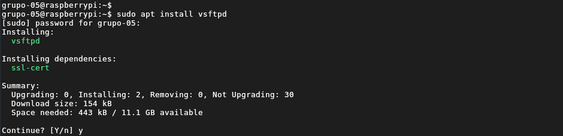
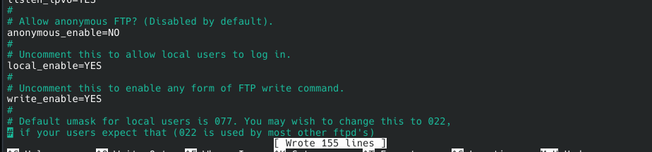
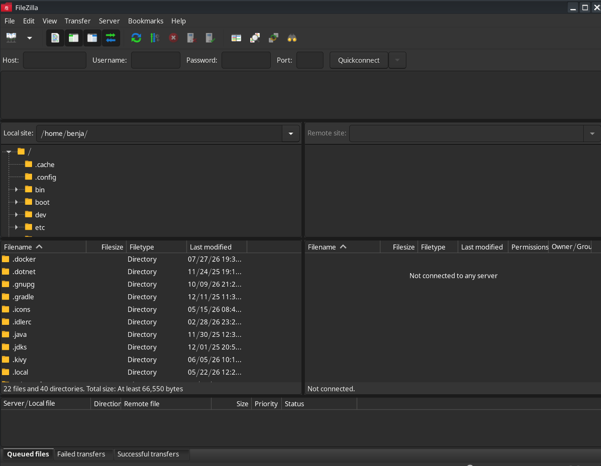
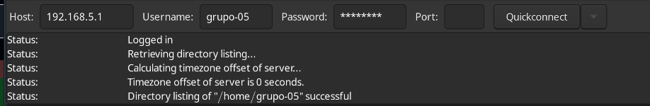
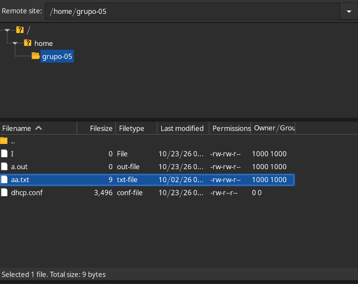
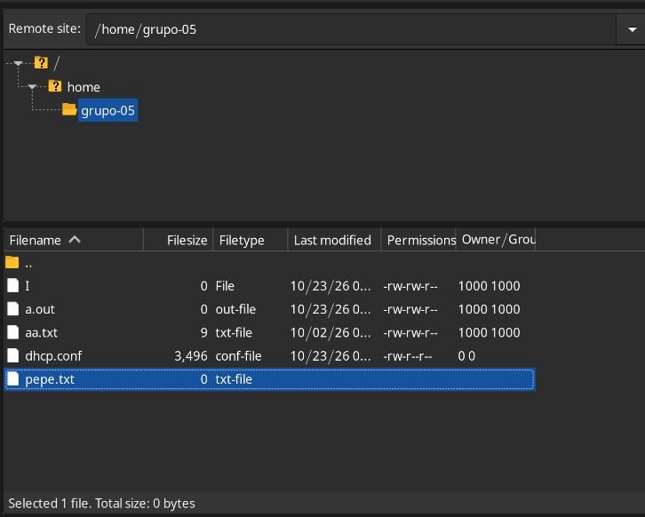

[← Volver](../README.md)

# Entrega 4: File Transfer Protocol (FTP)


## Integrantes del Grupo 5

- Lorenzo Palacios
- Benjamin Fasioli
- Octavio Paez
- Ramiro Cardo
- Sebastian Weiss

## Objetivo

Instalar y configurar un servidor FTP en una Raspberry Pi utilizando el software `vsftpd`, con el propósito de permitir la transferencia de archivos entre los equipos conectados a la red local (LAN).

Además, comprobar el funcionamiento y la accesibilidad del servicio mediante un cliente FTP, en este caso FileZilla, verificando la autenticación de un usuario local, la visualización de archivos y la posibilidad de realizar transferencias.

## Entorno de trabajo

| Elemento | Información |
|---|---|
| Modelo de Raspberry Pi | **Raspberry Pi 4 B+** |
| Sistema operativo de la Raspberry Pi | **Raspberry Pi OS Lite** |
| Tipo de conexión de red | **Ethernet** |
| Nombre del usuario de la Raspberry Pi | **grupo-05** |
| Dirección IP de la Raspberry Pi | **192.168.5.1** |
| Red local | **192.168.5.0/24** |
| Software del servidor FTP | **vsftpd** |
| Aplicación cliente FTP | **FileZilla** |

Ambos equipos se encontraban conectados a la misma red local durante la actividad. La Raspberry Pi funcionó como servidor FTP, mientras que la computadora del grupo actuó como cliente.

## Materiales y recursos utilizados

- Raspberry Pi.
- Tarjeta microSD con el sistema operativo instalado.
- Computadora cliente con entorno gráfico.
- Conexión de red local mediante Ethernet.
- Cable Ethernet.
- Fuente de alimentación para la Raspberry Pi.
- Monitor, teclado y cable HDMI para la configuración inicial de la Raspberry Pi.
- Paquete `vsftpd` para implementar el servidor FTP.
- Aplicación FileZilla para realizar las conexiones y transferencias de archivos.
- Usuario local `grupo-05` y su contraseña.
- Guía de referencia: [Tutorial: Raspberry Pi como servidor FTP](https://web.archive.org/web/20250806044429/https://geekytheory.com/tutorial-raspberry-pi-9-servidor-ftp/).
- Documentación: [FileZilla Client Tutorial](https://wiki.filezilla-project.org/FileZilla_Client_Tutorial_%28es%29).
- Documentación complementaria: [WinSCP - FTPS](https://winscp.net/eng/docs/ftps).

## Definiciones

**FTP (File Transfer Protocol):** es un protocolo de comunicación utilizado para transferir archivos entre diferentes equipos conectados a una red. Permite realizar operaciones como subir, descargar, consultar, eliminar y renombrar archivos, según los permisos disponibles.

**Servidor FTP:** es el equipo que ofrece el servicio de transferencia de archivos y espera las conexiones de los clientes. En esta actividad, la Raspberry Pi cumple esta función.

**Cliente FTP:** es el programa o equipo que inicia una conexión con el servidor para acceder a sus archivos y realizar transferencias. En nuestro caso, utilizamos FileZilla.

**vsftpd (Very Secure FTP Daemon):** es un software servidor FTP para sistemas Linux. Se ejecuta como un servicio en segundo plano y se encarga de recibir y atender las conexiones de los clientes.

**Daemon:** es un proceso que se ejecuta en segundo plano en un sistema operativo, proporcionando un servicio sin necesidad de mantener una terminal abierta.

**FileZilla:** es una aplicación cliente FTP que permite conectarse a un servidor, visualizar los archivos del equipo remoto y transferir archivos entre ambos equipos.

**Dirección IP:** es una dirección lógica que identifica a un dispositivo dentro de una red. Permite localizarlo y establecer comunicaciones con él. En esta actividad, la Raspberry Pi utiliza la dirección `192.168.5.1`.

**Puerto:** es un identificador numérico que permite distinguir los servicios y las conexiones de red de un equipo. FTP utiliza tradicionalmente el puerto TCP 21 para su canal de control.

**Autenticación:** es el proceso mediante el cual se verifica la identidad de un usuario, generalmente mediante un nombre de usuario y una contraseña.

**LAN (Local Area Network):** es una red de área local que conecta dispositivos dentro de un espacio limitado, como un aula o laboratorio.

## Procedimiento

### 1. Preparación de la conexión a Internet e instalación de vsftpd

Antes de comenzar con la instalación, fue necesario deshacer temporalmente algunas configuraciones realizadas en el práctico anterior para recuperar el acceso a Internet desde la Raspberry Pi. Esto permitió descargar los paquetes necesarios desde los repositorios de Debian.

El primer paso consistió en instalar `vsftpd` (*Very Secure FTP Daemon*), el software que permite implementar el servidor FTP. Para ello, utilizamos el gestor de paquetes APT:

```bash
sudo apt install vsftpd
```

El comando utiliza `sudo` para obtener permisos de administrador, `apt install` para instalar un paquete y `vsftpd` para indicar el software que queremos instalar.



### 2. Configuración de vsftpd

Una vez instalado el servidor, modificamos su archivo principal de configuración, ubicado en:

```text
/etc/vsftpd.conf
```

Para editarlo utilizamos el editor de texto Nano con permisos de administrador:

```bash
sudo nano /etc/vsftpd.conf
```

Dentro del archivo agregamos las siguientes opciones:

```conf
local_enable=YES
write_enable=YES
```

Estas opciones permiten modificar el comportamiento del servidor:

- `local_enable=YES`: habilita la autenticación de usuarios locales del sistema operativo. De esta manera, los usuarios existentes en la Raspberry Pi, como `grupo-05`, pueden iniciar sesión en el servidor FTP.
- `write_enable=YES`: habilita los comandos FTP que permiten realizar operaciones de escritura, como subir archivos, eliminarlos o renombrarlos, siempre que el usuario tenga los permisos correspondientes sobre los directorios y archivos.

La primera opción permite que los usuarios locales puedan autenticarse, mientras que la segunda habilita las operaciones de escritura sobre los recursos a los que tengan acceso.



### 3. Reinicio del servicio FTP

Luego de modificar el archivo de configuración, reiniciamos el servicio para que los cambios realizados fueran aplicados:

```bash
sudo service vsftpd restart
```

El comando utiliza `service` para administrar el servicio `vsftpd` y la opción `restart` para reiniciarlo.

Esto permite que el servidor vuelva a iniciarse leyendo las nuevas opciones de configuración.


### 4. Instalación de FileZilla

Para comprobar el funcionamiento del servidor, instalamos FileZilla en la computadora cliente.

FileZilla es un programa que permite establecer conexiones FTP con servidores remotos y administrar las transferencias de archivos mediante una interfaz gráfica.

A diferencia de `vsftpd`, que funciona en la Raspberry Pi y ofrece el servicio, FileZilla actúa como cliente y permite conectarse a dicho servicio.



### 5. Restablecimiento de la LAN y conexión al servidor FTP

Una vez instalado `vsftpd`, volvimos a realizar los últimos pasos de la configuración del práctico anterior para restablecer la red local aislada entre la Raspberry Pi y la notebook.

La Raspberry Pi volvió a utilizar la dirección IP `192.168.5.1`, correspondiente a nuestra red local.

Desde FileZilla, ingresamos los datos necesarios para conectarnos al servidor FTP:

| Campo | Valor |
|---|---|
| Servidor (Host) | `192.168.5.1` |
| Usuario | `grupo-05` |
| Contraseña | Contraseña del usuario `grupo-05` |
| Puerto | `21` |

El puerto 21 corresponde al canal de control tradicional del protocolo FTP, mediante el cual el cliente y el servidor intercambian comandos y respuestas.

Al iniciar la conexión, el servidor `vsftpd` recibe la solicitud, verifica las credenciales del usuario y, si la autenticación es correcta, permite acceder a los directorios autorizados.



### 6. Comprobación del acceso a los archivos del servidor

Una vez establecida la conexión, comprobamos que FileZilla permitía visualizar los archivos correspondientes al directorio personal del usuario `grupo-05` en la Raspberry Pi.

En la interfaz de FileZilla se muestran dos paneles:

- **Sitio local:** representa los archivos y directorios de la computadora cliente.
- **Sitio remoto:** representa los archivos y directorios disponibles en el servidor FTP.

De esta manera, pudimos comprobar que la autenticación se había realizado correctamente y que el usuario podía acceder al contenido de su directorio personal.



### 7. Comprobación de la transferencia de archivos

Por último, creamos un archivo llamado `pepe.txt` para comprobar el funcionamiento de la conexión y las operaciones de escritura mediante FTP.

Esta prueba permitió verificar que, además de establecer una conexión y visualizar los archivos del servidor, era posible trabajar con archivos a través del servicio FTP.

La posibilidad de realizar esta operación depende tanto de la opción `write_enable=YES` como de los permisos de escritura del usuario sobre el directorio correspondiente.



## Comprobaciones realizadas

| Comprobación | Procedimiento o comando | Resultado obtenido |
|---|---|---|
| Instalación del servidor FTP | `sudo apt install vsftpd` | Se instaló el paquete del servidor FTP. |
| Configuración del acceso de usuarios locales | `local_enable=YES` en `/etc/vsftpd.conf` | Se habilitó la autenticación de usuarios locales. |
| Habilitación de operaciones de escritura | `write_enable=YES` en `/etc/vsftpd.conf` | Se habilitaron los comandos FTP de escritura. |
| Aplicación de la configuración | `sudo service vsftpd restart` | Se reinició el servicio para aplicar los cambios. |
| Conexión desde el cliente | FileZilla, servidor `192.168.5.1`, usuario `grupo-05` | Se estableció la conexión con la Raspberry Pi. |
| Acceso a los archivos | Visualización del sitio remoto en FileZilla | Se visualizaron los archivos del directorio personal del usuario. |
| Comprobación de escritura | Creación y transferencia de `pepe.txt` | Se realizó la prueba de transferencia de archivos. |

## Resultado

Se logró instalar y configurar correctamente un servidor FTP en la Raspberry Pi utilizando el software `vsftpd`.

Posteriormente, mediante FileZilla, establecimos una conexión desde la computadora cliente hacia la Raspberry Pi a través de la red local, utilizando la dirección IP `192.168.5.1` y las credenciales del usuario `grupo-05`.

La conexión permitió visualizar los archivos del directorio personal del usuario y realizar la prueba con el archivo `pepe.txt`, comprobando el funcionamiento de las operaciones de transferencia habilitadas.

De esta manera, la Raspberry Pi quedó configurada para ofrecer un servicio de transferencia de archivos accesible desde otros equipos de la LAN.


## Conclusión

A través de esta actividad aprendimos a instalar, configurar y utilizar un servidor FTP en una Raspberry Pi, incorporando un nuevo servicio a la infraestructura de red local que venimos desarrollando.

Comprendimos la diferencia entre un servidor y un cliente FTP, el funcionamiento del software `vsftpd` y la importancia de los parámetros de configuración que permiten habilitar la autenticación de usuarios locales y las operaciones de escritura.

Finalmente, mediante FileZilla comprobamos que una computadora conectada a la misma LAN podía acceder al servidor, visualizar sus archivos y realizar transferencias.

De esta manera, logramos cumplir con el objetivo de la actividad y ampliar los servicios que nuestra Raspberry Pi puede proporcionar dentro de la red local.
